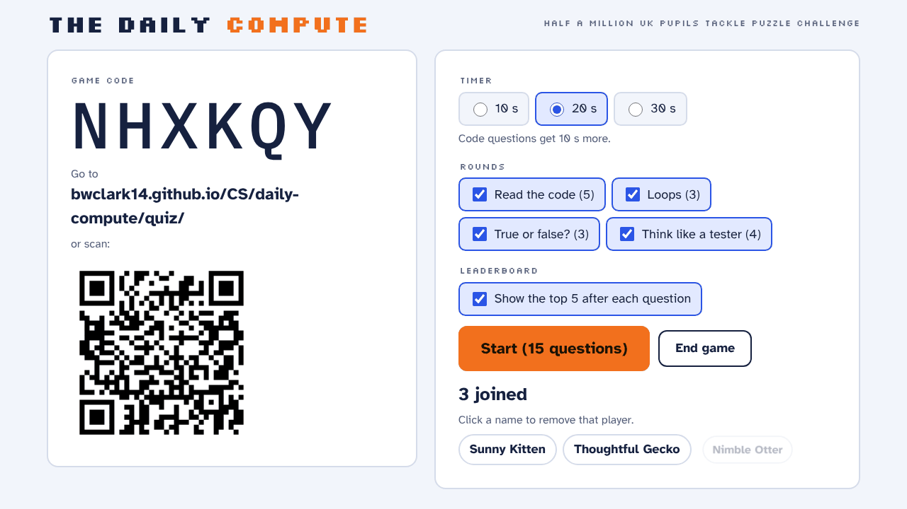
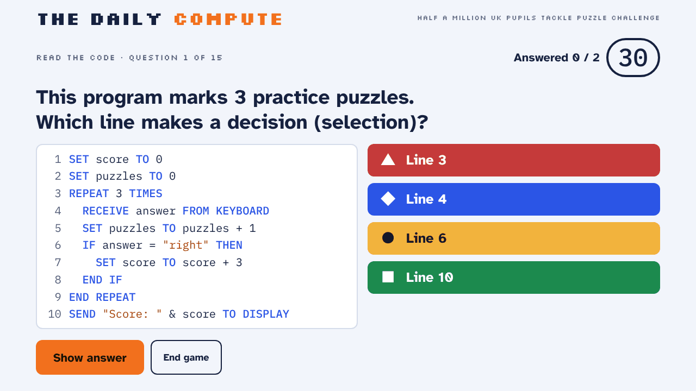
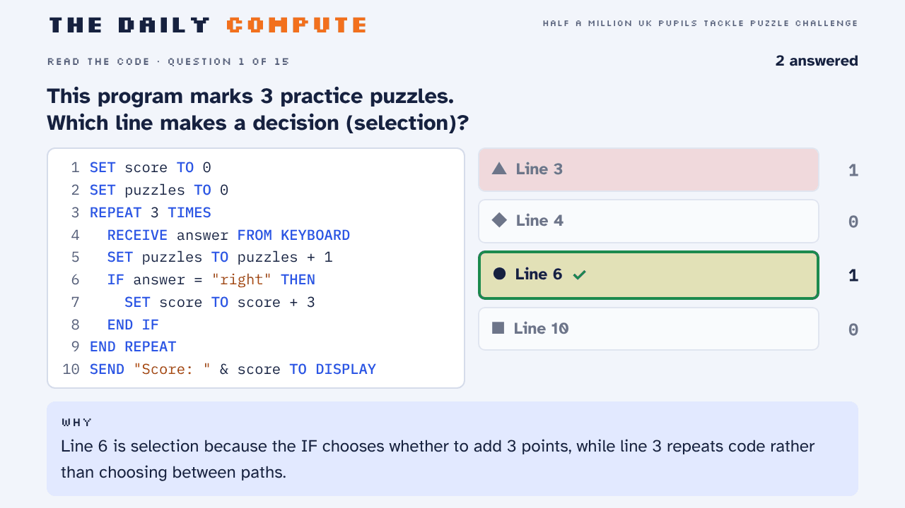
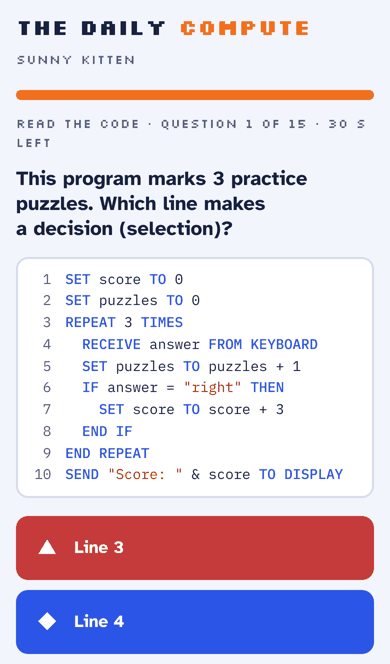
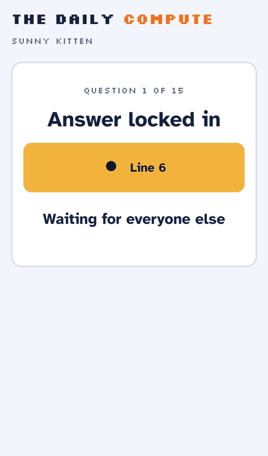
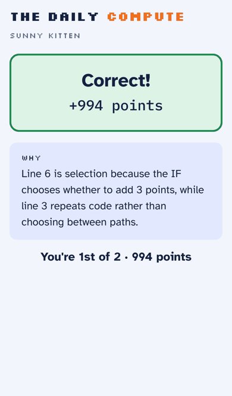
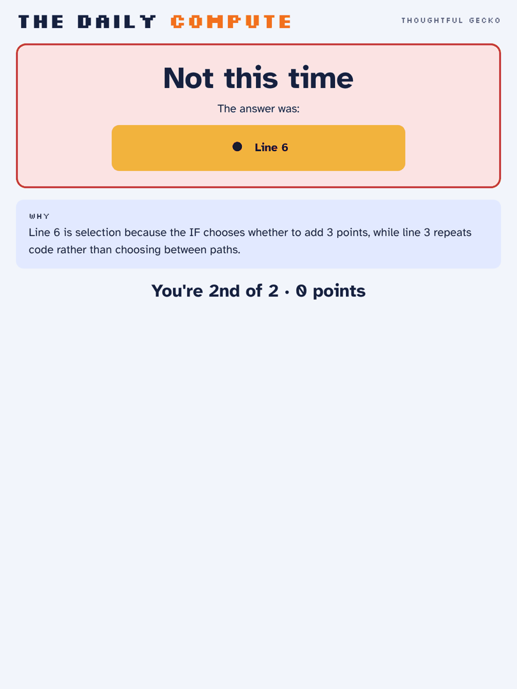

# The Daily Compute: group quiz

A live, Kahoot-style quiz for a class. The teacher puts a game code on the board; pupils join on their
own devices (phones, iPads, Chromebooks, laptops) and answer questions about reading code and
computational thinking, themed on the day's story.

- **Quiz page:** <https://bwclark14.github.io/CS/daily-compute/quiz/> (`daily-compute/quiz/index.html`).
  It isn't linked from anywhere on the site and is marked `noindex`, so search engines leave it out.
- **Questions:** one file per story in `daily-compute/group-quiz/<story-id>.json`, checked by
  `tools/daily-compute/validate_group_quiz.py`. Separate from `stories.json`, so the main page and the
  daily publishing task are not affected.
- **Game server:** this folder. A Cloudflare Worker with one Durable Object per game, on the free plan.

| Teacher lobby | Question on the board | Reveal |
|---|---|---|
|  |  |  |

| Pupil question (phone) | Answer locked in | Result (phone) | Result (iPad) |
|---|---|---|---|
|  |  |  |  |

## How it works

```
Teacher's laptop ──POST /games (question set)──▶ Worker ──▶ Durable Object for game "HMVRMD"
     │                                                        (runs in Western Europe)
     └── WebSocket ?role=teacher&key=… ─────────────────────▶ │
Pupil devices ──── WebSocket ?role=pupil&token=… ───────────▶ │  timer, answers, scores: in memory only
```

1. The teacher opens the quiz page and presses **Start a group quiz**. The page picks today's story
   (the newest story in `stories.json` dated today or earlier, UK time), loads its question file and
   sends it to the Worker.
2. The Worker makes a 6-character game code (no vowels and no look-alikes such as O/0 or I/1) and a
   secret teacher key (256 random bits), and starts a Durable Object for that code. The key stays in
   the teacher's browser tab (`sessionStorage`), so refreshing the tab keeps control of the game.
3. Pupils type the code or scan the QR code. Each pupil gets a random, kind name such as "Swift Otter"
   (they can ask for a different one in the lobby) and a random token, kept in their tab so a refresh
   or a dropped connection rejoins with the same name and score.
4. The server runs the game. It starts and stops each question's timer, accepts one answer per pupil
   per question only while the question is open, and scores it with its own clock:
   **correct = 500 + up to 500 for speed** (linear over the timer), wrong or no answer = 0, polls score
   nothing. The correct answer and explanation are sent to devices only at the reveal.
5. The game ends when the teacher presses **End game** (or **Finish and delete the game**), 10 minutes
   after the teacher's tab disconnects without coming back, or 3 hours after it was created, whichever
   comes first. Then everything about it is dropped.

### Data: what exists, where, and when it's deleted

You can share this section with your school.

| What | Where | Deleted |
|---|---|---|
| The question set (from the public question file) | Memory of the game's Durable Object | When the game ends |
| Each pupil's random name (e.g. "Swift Otter"), a random token, score, and their answer to the current question | Memory of the game's Durable Object | When the game ends. A removed pupil's name and score are dropped straight away |
| The token and random name on the pupil's device | That browser tab's `sessionStorage` | When the tab is closed (or the game ends) |
| The teacher key | Memory of the game, and the teacher's browser tab (`sessionStorage`) | When the game ends / the tab is closed |
| The game's end time (an "alarm") | Durable Object storage. This is the only thing written to storage, and it holds no pupil data | When the game ends |

- **No accounts, logins, emails or real names.** Pupils never type their name.
- **Nothing about pupils is stored.** No Durable Object storage, KV, D1 or analytics. Workers Logs
  (observability) are switched off in `wrangler.toml`, and the code never logs names or answers.
- A game always ends within **3 hours**, and a game the teacher has left ends after **10 minutes**.
- Like any website, Cloudflare handles the network connection itself (for example, IP addresses to
  deliver traffic). The game does not record them.
- If every device disconnects at once, the server may free the game's memory after about a minute,
  and the game is gone. Start a new one.

## Deploy it (one-off, about 15 minutes)

You need a computer where you can install software, and an email address for a free Cloudflare account.

1. **Create a free Cloudflare account** at <https://dash.cloudflare.com/sign-up>. The free plan is enough.
2. **Install Node.js** (the "LTS" version) from <https://nodejs.org>.
3. **Get this folder** onto your computer: on GitHub, open the repository (on the
   `daily-compute-group-quiz` branch until it's merged), use **Code → Download ZIP**, unzip it, and
   find the `cloudflare/group-quiz` folder.
4. **Open a terminal in that folder.** On Windows: open the folder in File Explorer, click the address
   bar, type `cmd` and press Enter. On a Mac: right-click the folder → **New Terminal at Folder**.
5. Run these three commands, one at a time:
   ```
   npm install
   npx wrangler login
   npx wrangler deploy
   ```
   `wrangler login` opens a browser window: sign in to Cloudflare and click **Allow**. You don't need
   to copy any tokens or account IDs anywhere. The last command prints the Worker's address, something
   like `https://daily-compute-group-quiz.your-name.workers.dev`.
6. **Tell the quiz page where the server is.** In `daily-compute/quiz/index.html`, find
   `const WORKER_URL = "";` near the top of the script and paste the address between the quotes:
   ```js
   const WORKER_URL = "https://daily-compute-group-quiz.your-name.workers.dev";
   ```
   Commit that change. Until it's set, the quiz page shows a friendly "isn't set up yet" message.
7. **Test it on the school network** with one laptop (teacher) and one pupil device: start a quiz on
   the laptop, join with the code on the other device, play a couple of questions, then press
   **End game**. If the pupil device can't connect, ask IT to allow `*.workers.dev` (or your Worker's
   address) and WebSocket connections to it.

To check the server is running, open the Worker's address in a browser: it says
"The Daily Compute group quiz server is running."

**Free plan limits.** Each game uses one Durable Object while devices are connected. The free plan
allows plenty for a school (roughly 25+ hours of games a day). Nothing is charged unless you add a
payment method and upgrade.

## Add questions for a story

Make `daily-compute/group-quiz/<story-id>.json` (the `id` from `stories.json`) and check it:

```
python3 tools/daily-compute/validate_group_quiz.py daily-compute/group-quiz/<story-id>.json
python3 tools/daily-compute/validate_group_quiz.py --all
```

Format: `{"storyId", "title", "rounds": [{"name", "questions": [...]}]}`, 10-16 questions in total.
Each question has `type`, `q`, optional `code` (a list of `{"code", "indent"}` lines in the site's
pseudocode), `options` (2-4), `answer` (the index; left out for polls) and `explain` (one sentence:
why the answer is right and why the most tempting wrong answer is wrong; for a poll, a "Talk about it"
prompt).

| Type | Asks | Extra fields the checker uses |
|---|---|---|
| `identify` | which line is selection/input/output, which are the variables, loop type, data type | `inputs` if the code receives input |
| `count` | how many times something is displayed | `match`: the displayed text to count |
| `truefalse` | does a condition evaluate to TRUE or FALSE; options exactly `["TRUE","FALSE"]` | `condition` |
| `trace` | what is displayed (several lines joined with " / "), or a variable's value | `variable` (optional), `inputs` |
| `testdata` | normal / boundary / exceptional | `range: [low, high]` plus `value` (options are the three kinds) or `kind` (options are values) |
| `ct` | decomposition, abstraction, pattern spotting, algorithms | |
| `poll` | an opinion question; no answer, scores nothing | |

The checker runs every code question with `tools/daily-compute/pseudo.py`, so a wrong answer key, a
"wrong" option that is actually right, bad indentation or lower-case keywords fail the check. It also
fails questions that repeat the story's own quiz or activities.

## Test it

**Unit tests** (game logic, in the real Workers runtime):

```
cd cloudflare/group-quiz
npm install
npm test
```

They check that only the teacher can control the game, one answer per pupil per question, late answers
are rejected, scores are right, answers are never sent before the reveal, limits are enforced
(60 pupils, 2 KB messages, rate limit, allowed origins), and state is dropped at the end.

**On your own computer:**

```
cd cloudflare/group-quiz && npx wrangler dev --port 8787     # the game server
cd ../.. && python3 -m http.server 8765                       # the site, from the repo root
```

Open `http://localhost:8765/daily-compute/quiz/?server=http://localhost:8787` in one window (teacher)
and the same address in another browser or a private window (pupil). The `?server=` setting only
works on `localhost`, never on the live site.

## Settings and limits

| | |
|---|---|
| Timer | 10, 20 or 30 seconds (code questions get 10 s more) |
| Rounds | choose which rounds to play |
| Leaderboard | on/off (top 5 after each question). The final podium (top 3) always shows |
| Pupils | up to 60 per game |
| Messages | over 2 KB are ignored; each connection may send about 5 a second |
| Origins | only `https://bwclark14.github.io`, and `http://localhost` / `http://127.0.0.1` for testing |

## Protocol

All messages are JSON with a `t` field.

**`POST /games`** with `{"quiz": <question file>, "settings": {"timer", "rounds", "leaderboard"}}`
→ `201 {"code": "HMVRMD", "key": "<secret>"}`.

**`GET /games/<code>/ws?role=teacher&key=…`** or **`?role=pupil`** (first time) /
**`?role=pupil&token=…`** (rejoin) upgrades to a WebSocket.

Sent by the teacher:

| `t` | When | Fields |
|---|---|---|
| `settings` | lobby | `timer` (10/20/30), `rounds` (indices), `leaderboard` (true/false) |
| `start` | lobby | |
| `reveal` | question | ends the timer early |
| `next` | reveal / leaderboard | to the leaderboard (if on), the next question or the final results |
| `kick` | any time | `id` of the pupil |
| `end` | any time | ends the game and drops everything |

Sent by a pupil: `reroll` (lobby only) and `answer` with `q` (question index) and `a` (option index).
Anyone may send `ping` (answered with `pong`). Anything else is ignored, including teacher actions
sent by a pupil.

Sent by the server:

| `t` | Fields |
|---|---|
| `welcome` | pupil: `token`, `name` (also after a reroll); teacher: `role` |
| `state` | absolute state, sent after every change so a reconnecting device catches up: `phase` (`lobby`, `question`, `reveal`, `board`, `final`), `index`, `total`, `players`, and during a question `question` (`n`, `total`, `round`, `type`, `poll`, `q`, `code`, `options`, never the answer), `endsInMs`, `durationMs`. The **teacher** also gets `title`, `settings`, `rounds`, `questionCount`, `list` (every pupil's `id`, `name`, `score`, `connected`), `answered`/`expected`, and at the reveal `reveal` (`answer`, `explain`, `counts`), on the leaderboard `leaderboard` (top 5) and at the end `podium` (top 3). A **pupil** gets only their own `name`, `score`, `answered`, `choice`, `late`, and from the reveal on their `result` (`correct`, `points`, `answer`, `explain`), `place` and `of` |
| `error` | `code` (`no_game`, `bad_key`, `full`, `removed`, `finished`, `replaced`, `bad_request`) and a friendly `msg`; the socket then closes with code 4001-4009 |
| `ended` | the game has ended; the socket closes with code 4006 |

## Design notes

- **No WebSocket hibernation.** The Hibernation API lets an idle Durable Object leave memory while
  sockets stay open, but this game keeps everything in memory on purpose (nothing about pupils may be
  written to storage), so hibernating would wipe a game mid-lesson. Games are short and few, so
  ordinary WebSockets fit well within the free plan.
- One Durable Object per game, named by the game code, with a Western Europe location hint (`weur`).
- The QR code uses `qrcode-generator` 1.4.4 from cdnjs, pinned to that exact version. If it can't
  load, the lobby still shows the code and the address.
